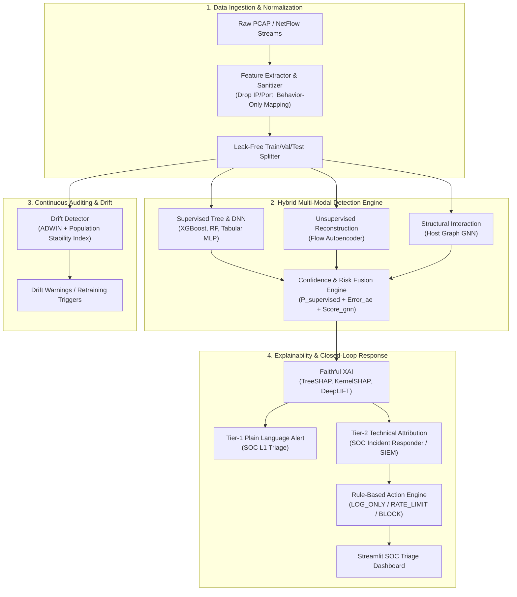

# Domain-Generalizable, Explainable & Resilient Network Intrusion Detection (NIDS)

[](https://www.python.org/downloads/)
[](https://pytorch.org/)
[](LICENSE)
[](tests/)
[](src/utils/reproducibility.py)

An end-to-end research framework and operational pipeline for **Machine Learning Network Intrusion Detection Systems (ML-NIDS)**. Rather than chasing inflated in-distribution benchmark accuracies, this repository prioritizes **rigorous cross-dataset evaluation**, **graph-context anomaly fusion**, **faithful explainability (XAI)**, **automated SOC incident response**, and **honestly framed adversarial robustness**.

---

## Table of Contents

- [Key Motivations & Honest Framing](#key-motivations--honest-framing)
- [System Architecture](#system-architecture)
- [Core Capabilities by Phase](#core-capabilities-by-phase)
  - [Phase 1 & 2: Generalization & Baseline Benchmark](#phase-1--2-cross-dataset-generalization--feature-engineering)
  - [Phase 3: Multi-Modal Detection Depth (Autoencoder, GNN, Drift, Fusion)](#phase-3-detection-depth--temporal-graph-monitoring)
  - [Phase 4: Faithfulness, Tiered XAI & Closed-Loop SOC Response](#phase-4-explainability-tiered-xai--soc-response)
  - [Phase 5: Constrained Adversarial Robustness](#phase-5-constrained-adversarial-robustness)
- [Repository Structure](#repository-structure)
- [Quickstart Guide](#quickstart-guide)
  - [1. Prerequisites & Installation](#1-prerequisites--installation)
  - [2. Synthetic Data Generation](#2-synthetic-data-generation)
  - [3. Running Unit & Integration Tests](#3-running-unit--integration-tests)
- [Running Experimental Pipelines](#running-experimental-pipelines)
- [Interactive Streamlit SOC Dashboard](#interactive-streamlit-soc-dashboard)
- [Configuration Reference](#configuration-reference)
- [Research Ethics & Reproducibility](#research-ethics--reproducibility)

---

## Key Motivations & Honest Framing

Modern literature in ML-based NIDS frequently reports >99% detection accuracy on static datasets (such as CIC-IDS2017 or UNSW-NB15). However, models deployed in production networks routinely collapse due to:
1. **Shortcut Learning & Identity Leakage:** Models memorizing transient IP subnets, static port numbers, or capture-specific packet header artifacts rather than fundamental protocol/behavioral anomalies.
2. **Distributional Drift:** Inevitable shifts in network traffic patterns over time that invalidate static boundaries.
3. **Black-Box Opacity:** Unexplained alerts that burden SOC analysts with high false-positive verification costs.
4. **Vulnerability to Evasion:** Sensitivity to slight perturbations in traffic flow statistics.

### The Research Principles of this Project
- **Zero Leakage:** Strictly isolates preprocessing fit parameters to training partitions. All identifying IPs and ephemeral ports can be stripped to evaluate *behavior-only statistical features*.
- **Multi-Seed Significance Testing:** All comparative claims are evaluated across identical random seeds (`42, 123, 456, 789, 1024`) with paired parametric ($t$-test) and non-parametric (Wilcoxon signed-rank, McNemar, bootstrap CIs) hypothesis tests.
- **Problem-Space vs. Feature-Space Distinction:** Feature-space adversarial perturbations (e.g., continuous FGSM/PGD on flow durations or byte counters) are treated as *empirical sensitivity analyses*, rather than claiming immunity against routable, physical packet-level evasion.
- **Fail-Safe Response:** The automated mitigation engine enforces dry-run execution by default, preventing unintended network disruptions.

---

## System Architecture



---

## Core Capabilities by Phase

### Phase 1 & 2: Cross-Dataset Generalization & Feature Engineering
- **Baseline Models:** High-performance tabular classifiers (`XGBoost`, `RandomForestClassifier`, PyTorch `DNNBaseline`).
- **Feature Set Decomposition:**
  - *Full Feature Set:* Flow statistics + transport identifiers.
  - *Behavior-Only Feature Set:* Purely behavioral flow metrics (inter-arrival times, packet length distributions, TCP flag dynamics) with IP and port identifiers systematically purged.
- **Cross-Domain Evaluation Matrix:** Evaluates 9 cross-domain combinations across benchmark datasets (CIC-IDS2017, UNSW-NB15, and lab-captured traffic) to measure the empirical generalization drop ($\Delta F_1$).
- **Statistical Engine:** Dependency-free, numerically validated statistical tests in [`src/evaluation/statistics.py`](src/evaluation/statistics.py) cross-checked against SciPy.

### Phase 3: Detection Depth & Temporal-Graph Monitoring
- **Deep Anomaly Autoencoder:** Symmetric bottleneck MLP (`src/models/autoencoder.py`) with reconstruction error thresholding for zero-day / out-of-distribution flow detection.
- **Host Interaction Graph Neural Network (GNN):** PyTorch Geometric model (`src/models/gnn_detector.py`) modeling inter-host communication graphs to identify structural scanning, lateral movement, and botnet fan-out patterns.
- **Real-Time Concept Drift Detection:** Dual-layer statistical monitoring (`src/drift/drift_detector.py`) combining **ADWIN** (Adaptive Windowing) for online streaming drift with **PSI** (Population Stability Index) for feature distribution divergence.
- **Tri-Modal Fusion:** Weighted consensus combining supervised probability, reconstruction residual, and graph embedding anomaly scores.

### Phase 4: Explainability, Tiered XAI & SOC Response
- **Attribution Algorithms:** Support for `TreeSHAP`, `KernelSHAP`, and Captum-based `DeepLIFT`.
- **Faithfulness Benchmarking:** Implementation of **Deletion AUC** (gradually masking top features and measuring confidence collapse) and **Insertion AUC** to empirically prove explanation accuracy.
- **Two-Tiered Alert Generation:**
  - **Tier-1 (L1 Analysts):** Human-readable threat narratives (e.g., *"Anomalous TCP SYN burst detected from internal host 10.0.0.5"*).
  - **Tier-2 (Forensics / L3):** Structured JSON metadata detailing mathematical feature contributions, exact packet counters, and mitigation rationale.
- **Automated Mitigation Engine:** Policy-driven graduated response (`LOG_ONLY`, `RATE_LIMIT`, `BLOCK`) with cooldown tracking and CIDR whitelist enforcement.

### Phase 5: Constrained Adversarial Robustness
- **Feature-Space Attack Generation:** Targeted and untargeted implementations of **FGSM** (Fast Gradient Sign Method) and **PGD-10** (Projected Gradient Descent).
- **Domain Constraint Enforcement:** Bounded perturbations maintaining domain physics (e.g., packet counts $\ge 1$, durations $\ge 0$, integer-constrained discrete counters).
- **Black-Box Surrogate Transfer:** Transferring gradient perturbations generated against neural surrogate models onto non-differentiable gradient-boosted decision trees.
- **Adversarial Training:** Defending PyTorch tabular models through empirical mini-batch mixture training (50% clean + 50% FGSM).

---

## Repository Structure

```text
NIDS/
├── configs/                       # Centralized YAML configuration files
│   ├── anomaly_detection.yaml     # Autoencoder hyperparameters & threshold rules
│   ├── baseline.yaml              # Hyperparameters for XGBoost & Random Forest
│   ├── cross_dataset.yaml         # Matrix evaluation & seed configurations
│   ├── datasets.yaml              # Dataset pathing and column mappings
│   ├── default.yaml               # Master pipeline configuration
│   ├── drift.yaml                 # ADWIN & PSI drift thresholds
│   ├── explainability.yaml        # SHAP / DeepLIFT background sample sizes
│   ├── feature_schema.yaml        # Complete canonical 42-feature schema
│   ├── gnn.yaml                   # PyTorch Geometric GNN architecture
│   ├── response.yaml              # Incident response thresholds and policy
│   └── robustness.yaml            # Adversarial epsilon sweep parameters
├── data/                          # Data directory (ignored from Git tracking)
│   ├── cic_ids_2017/              # Optional: Place raw CIC-IDS2017 CSVs here
│   ├── unsw_nb15/                 # Optional: Place raw UNSW-NB15 CSVs here
│   ├── lab_captures/              # Local captures / synthetic lab flows
│   └── sample_data/               # Pre-generated synthetic validation data
├── docs/                          # Detailed milestone and phase summary docs
│   ├── phase1_summary.md          # Baseline performance & setup
│   ├── phase2_summary.md          # Cross-dataset generalization analysis
│   ├── phase3_summary.md          # Autoencoder, GNN, Drift, Fusion analysis
│   ├── phase4_summary.md          # Explainability & response validation
│   └── phase5_summary.md          # Adversarial robustness findings
├── planning/                      # Research specs, formal proposals, and rubrics
├── results/                       # Generated evaluation tables, logs, and figures
│   └── figures/                   # Confusion matrices, ROC curves, epsilon sweeps
├── scripts/                       # High-level pipeline drivers and runners
│   ├── generate_sample_data.py    # Generates synthetic multi-domain flows
│   ├── generate_lab_capture.py    # Generates realistic synthetic lab PCAP/flows
│   ├── train_baseline.py          # Trains and evaluates supervised baselines
│   ├── run_cross_dataset.py       # Executes 3x3 matrix evaluation & t-tests
│   ├── run_anomaly_detection.py   # Trains and benchmarks the Autoencoder
│   ├── run_gnn_detection.py       # Constructs host graphs and trains GNN
│   ├── run_drift_monitoring.py    # Simulates streaming drift & ADWIN detection
│   ├── run_phase3.py              # Consolidated Phase 3 runner
│   ├── run_phase4.py              # Consolidated Phase 4 runner (XAI + Response)
│   └── run_phase5.py              # Adversarial robustness sweep runner
├── src/                           # Core modular source code
│   ├── dashboard/                 # Streamlit SOC Dashboard application
│   ├── data/                      # Loaders, preprocessors, and graph builders
│   ├── drift/                     # ADWIN and PSI drift detectors
│   ├── evaluation/                # Cross-dataset, statistical, and robustness tools
│   ├── explainability/            # SHAP, DeepLIFT, and faithfulness modules
│   ├── models/                    # XGBoost, RF, Tabular DNN, AE, GNN, and Fusion
│   ├── response/                  # Policy-based remediation action engine
│   └── utils/                     # Config parsers, logging, and seed reproducibility
├── tests/                         # Pytest test suite (>330 unit/integration tests)
├── pyproject.toml                 # Package definition & build metadata
└── requirements.txt               # Pinned Python package dependencies
```

---

## Quickstart Guide

### 1. Prerequisites & Installation

- **OS:** Windows, Linux, or macOS
- **Python:** 3.11 or higher
- **Hardware:** CPU supported; NVIDIA GPU with CUDA recommended for rapid deep learning & GNN execution.

Clone the repository and set up a virtual environment:

```bash
# Clone repository
git clone https://github.com/your-org/nids.git
cd nids

# Create virtual environment
python -m venv .venv

# Activate virtual environment
# Windows (PowerShell):
.venv\Scripts\Activate.ps1
# Linux / macOS:
source .venv/bin/activate

# Upgrade pip and install dependencies
python -m pip install --upgrade pip
pip install -r requirements.txt

# Install nids in editable development mode
pip install -e .
```

### 2. Synthetic Data Generation

If external datasets (CIC-IDS2017, UNSW-NB15) are not present locally, you can instantly instantiate fully calibrated synthetic stand-in datasets to test all pipelines and models:

```bash
# Generate synthetic CIC-IDS2017 and UNSW-NB15 benchmark splits
python scripts/generate_sample_data.py

# Generate realistic synthetic host lab flows
python scripts/generate_lab_capture.py
```

### 3. Running Unit & Integration Tests

The repository maintains an extensive test suite verifying mathematical correctness, statistical validity, absence of data leakage, and system integration:

```bash
# Run the entire test suite
pytest tests/ -v

# Run targeted test suites
pytest tests/test_cross_dataset.py
pytest tests/test_faithfulness.py
pytest tests/test_robustness.py
```

---

## Running Experimental Pipelines

### Phase 1: Train Supervised Baselines
Trains baseline Random Forest and XGBoost classifiers on the primary dataset and produces evaluation metrics and confusion matrices:
```bash
python scripts/train_baseline.py
```

### Phase 2: Cross-Dataset Generalization Matrix
Executes the full cross-domain evaluation matrix comparing Full Features against Behavior-Only features, computing multi-seed Wilcoxon and paired $t$-test p-values:
```bash
python scripts/run_cross_dataset.py
```

### Phase 3: Anomaly Detection, GNN & Drift
Executes the unsupervised autoencoder, builds host communication graphs for the GNN detector, runs streaming concept drift detection, and evaluates detection fusion:
```bash
# Run all Phase 3 experiments
python scripts/run_phase3.py

# Or run individual submodules
python scripts/run_anomaly_detection.py
python scripts/run_gnn_detection.py
python scripts/run_drift_monitoring.py
```

### Phase 4: Explainability & Tiered Response Engine
Evaluates TreeSHAP and DeepLIFT attribution faithfulness (Deletion/Insertion AUC), constructs tiered analyst explanations, and tests policy-driven mitigations:
```bash
python scripts/run_phase4.py
```

### Phase 5: Adversarial Robustness Sweep
Evaluates white-box (FGSM, PGD-10) and surrogate black-box evasion attacks across perturbation levels $\epsilon \in [0.01, 0.50]$, training defended baselines with mixed-batch adversarial training:
```bash
python scripts/run_phase5.py
```

---

## Interactive Streamlit SOC Dashboard

The repository includes a production-grade, interactive SOC Security Dashboard built with Streamlit. It connects directly to live detection feeds, providing real-time alerts, SHAP waterfall explanations, network graph topology views, and firewall mitigation auditing.

```bash
# Launch the dashboard
streamlit run src/dashboard/app.py
```

Once running, navigate to `http://localhost:8501` in your browser.

### Dashboard Panels:
1. **Executive Overview:** High-level metrics showing total flows, active threat rate, fusion alert severity breakdown, and system health status.
2. **Real-Time Alert Feed:** Filterable tabular log of incoming network flows with color-coded severity badges (`LOW`, `MEDIUM`, `HIGH`, `CRITICAL`).
3. **Deep Explainability (XAI):** Interactive SHAP waterfall charts revealing exact feature attributions driving anomaly confidence.
4. **Network Graph Topology:** Visual representation of host communication graphs highlighting high-degree scanning nodes and compromised communication links.
5. **Drift & Concept Shift Monitor:** Live ADWIN change-point tracking and Population Stability Index (PSI) graphs indicating distribution shift.
6. **Automated Response Logs:** Audit trail of automated actions taken (`LOG_ONLY`, `RATE_LIMIT`, `BLOCK`) with operator manual override options.

---

## Configuration Reference

All experimental parameters and runtime behaviors are configured via YAML files in [`configs/`](configs/):

| File | Purpose | Key Parameters |
|---|---|---|
| `configs/default.yaml` | Master project configuration | Seeds, train/test split ratios, data normalization type |
| `configs/feature_schema.yaml` | Canonical network flow feature schema | Feature names, data types, statistical bounds, behavior-only mask |
| `configs/datasets.yaml` | Dataset paths and column mapping | Mapping raw dataset fields to canonical schema |
| `configs/cross_dataset.yaml` | Multi-dataset evaluation settings | Matrix pairings, seed lists, confidence thresholds |
| `configs/anomaly_detection.yaml` | Flow autoencoder settings | Layer dimensions, latent dimension, reconstruction percentile threshold |
| `configs/gnn.yaml` | Graph neural network settings | Number of GCN/GAT layers, aggregation strategy, graph construction window |
| `configs/drift.yaml` | Concept drift parameters | ADWIN delta sensitivity, PSI bin count and warning thresholds |
| `configs/explainability.yaml` | XAI evaluation parameters | Background distribution sample sizes, faithfulness deletion steps |
| `configs/response.yaml` | Automated action engine policy | Dry-run flag, severity thresholds, action cooldowns, CIDR whitelists |
| `configs/robustness.yaml` | Adversarial attack sweep settings | Epsilon values, PGD step size, physical feature constraint boundaries |

---

## Research Ethics & Reproducibility

1. **Deterministic Seeding:** The framework enforces global reproducibility across NumPy, PyTorch, and Python random engines via [`src/utils/reproducibility.py`](src/utils/reproducibility.py).
2. **Strict Leakage Prevention:** Preprocessors are fit exclusively on training folds; feature distributions from test or cross-evaluation partitions never leak into scalers or imputation models.
3. **Safe Automation:** Automated response mechanisms default to safe dry-run simulation mode (`dry_run: true` in `configs/response.yaml`) to protect production network availability.
4. **Transparent Results Reporting:** All empirical limitations (e.g. synthetic data fallbacks, problem-space vs feature-space evasion gaps, gradient masking under iterative attacks) are explicitly documented in corresponding phase reports within `docs/`.

---

## License

This project is licensed under the MIT License — see the [LICENSE](LICENSE) file for details.

